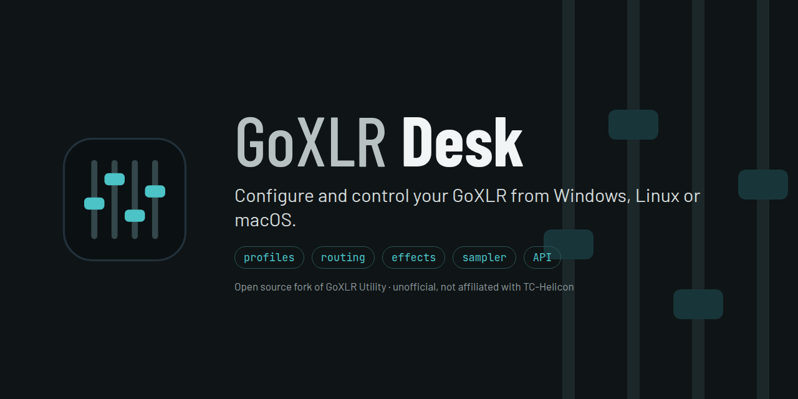
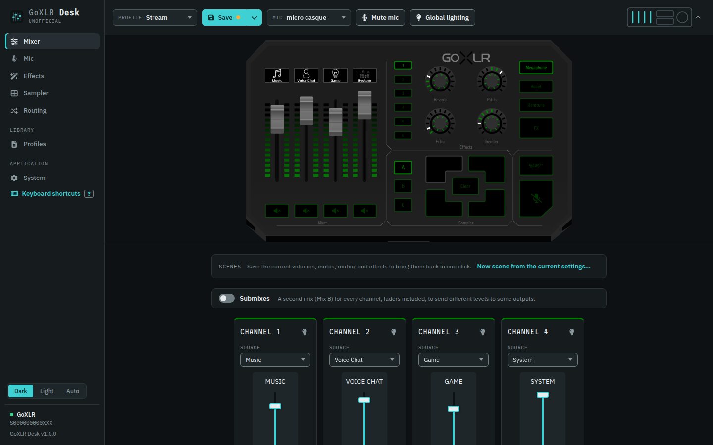

## GoXLR Desk

GoXLR Desk configures and controls a TC-Helicon GoXLR or GoXLR Mini from Windows, Linux or macOS: profiles,
routing, effects, sampler. Unofficial and open source.

Website: [powange.github.io/goxlr-desk](https://powange.github.io/goxlr-desk/)

> **A fork of GoXLR Utility.** GoXLR Desk is derived from [GoXLR Utility](https://github.com/GoXLR-on-Linux/goxlr-utility),
> made by the GoXLR on Linux team (Nathan Adams, Craig McLure and contributors), and keeps its MIT licence. It is a
> separate project, not supported by them: please report GoXLR Desk issues [here](https://github.com/powange/goxlr-desk/issues),
> not to GoXLR Utility.

On top of GoXLR Utility, GoXLR Desk has a redesigned interface, sample file management (browser, editor, trash), scenes,
undo, backups of the settings and profiles, network access with an access link, and a large set of fixes. Much of this
work was written with the help of AI.



## Features

* Full control over the GoXLR and GoXLR Mini (similar to the official app)
* Compatibility with profiles created by the official application
* An accessible UI designed to work well with assistive technologies
* Remote access: control your GoXLR from another device on your network, with an access link
* A sample library: browse, preview, edit, move and restore samples, drop them on the sampler buttons
* A sample 'pre-buffer': record audio from before you press the button
* Exit, sleep and wake actions, including saving profiles and loading other profiles / lighting
* Multiple device support: run more than one GoXLR on one PC
* A CLI and an HTTP / WebSocket API for scripting and automation

## Downloads

Downloads are available on the [Releases Page](https://github.com/powange/goxlr-desk/releases/latest) under the
'Assets' header:

* `.exe` files, for Windows (x64 and ARM)<sup>1</sup>
* `.deb` files, for Debian based systems (Debian 12+, Ubuntu 22.04+, Mint, Pop!_OS, etc)
* `.rpm` files, for Red Hat based systems (Fedora, etc) and openSUSE
* `.pkg` files, for macOS, when the release has them<sup>2</sup>

<sup>1</sup> Windows requires the official device drivers provided by TC-Helicon. If you have the official app
installed you don't need to do anything, otherwise get them from TC-Helicon's support page for the GoXLR.

<sup>2</sup> macOS support is still experimental.

### Next to GoXLR Utility

GoXLR Desk installs next to GoXLR Utility, with its own folder, settings and autostart. On its first start, it copies
GoXLR Utility's settings, profiles, mic profiles, samples, presets and icons, once: GoXLR Utility keeps its own and
keeps working. Only one of the two can control the GoXLR at a time: the second one started refuses to run.

On Linux, the `goxlr-desk` package replaces the `goxlr-utility` package (they install the same programs).

### OS specific notes

* On Windows on ARM, spoken messages use Windows' own voice: the NVDA and System Access libraries used to talk to
  screen readers are only available for x64
* On Linux, the interface opens in your web browser (the desktop app is built for Windows)

## Firmware updates

System > Firmware update shows the GoXLR's firmware and the latest version, and installs it. TC-Helicon's update
servers being offline, the list of versions and the firmware files come from the mirror kept by the GoXLR Utility
project (`utility.frostycoolslug.com`); the files are TC-Helicon's own firmware.

Before anything is written to the GoXLR, GoXLR Desk checks the download (size, version, and its SHA-256 when the list
gives one), then that the GoXLR received exactly that file (the CRC-32 the device returns for every chunk). Don't
unplug the GoXLR or close GoXLR Desk during an update. If an update goes wrong, GoXLR Utility's
[firmware updating guide](https://github.com/GoXLR-on-Linux/goxlr-utility/wiki/Firmware-Updating) explains how the
device recovers.

## Integrations

Tools made for GoXLR Utility use the same API and work with GoXLR Desk:

* [twitchat](https://twitchat.fr/) - Activate and change GoXLR settings based on twitch bits / donations
* [MacroGraph](https://www.macrograph.app/) - A visual programmer for streamers
* [OBS Fader Sync](https://github.com/parzival-space/obs-goxlr-fader-sync-plugin) - An OBS plugin to sync pre-mix
  volumes to fader volumes
* [Home Assistant](https://github.com/timmo001/homeassistant-integration-goxlr-utility) - Tie the GoXLR into your home
  automation
* [Stream Deck](https://github.com/FrostyCoolSlug/goxlr-utility-streamdeck)

System > Integrations, in the interface, shows the addresses and example commands for your device.

## Getting Started

Once installed, launch GoXLR Desk from the `GoXLR Desk` item in your applications menu. The interface is then
available from the system tray icon, or by running the menu item again.

The setup assistant (System > Setup assistant) helps with the first configuration. To use profiles
from the official app, open the profiles folder from Library > Profiles and copy them from the official app's folder
(normally `Documents/GoXLR`).

## Building

Building from source needs Rust 1.88 or later (see `rust-version` in `Cargo.toml`). On Linux, a few system
packages are needed too, on Debian / Ubuntu:

```
sudo apt-get install build-essential pkg-config libdbus-1-dev libspeechd-dev libpulse-dev
```

(On Fedora: `dbus-devel speech-dispatcher-devel pulseaudio-libs-devel pkgconf-pkg-config`.) Then:

```
cargo build --release
```

The binaries land in `target/release/`. On Linux, the udev rules in `50-goxlr.rules` need to be copied to
`/etc/udev/rules.d/` so the GoXLR can be used without root. The web interface is embedded from
`daemon/web-content/`, built from the [interface repository](https://github.com/powange/goxlr-desk-ui).

The Windows installers and the Linux packages can also be built without GitHub Actions, in a container: see
`ci/local/build.sh`. The icons are drawn by `daemon/resources/create-icons.py`.

## Questions and bug reports

Use the [issues of this repository](https://github.com/powange/goxlr-desk/issues). The System > Help link of the
interface opens them too.

## Disclaimer

GoXLR Desk is not supported by, or affiliated in any way with, TC-Helicon, nor with the GoXLR Utility project. GoXLR is
a trademark of TC-Helicon, used here only to say which device this software works with. For the official GoXLR
software, please refer to TC-Helicon's website.

This project accepts no responsibility or liability for use of this software, or any problems which may occur from its
use. Please read the [LICENSE](LICENSE) for more information.
